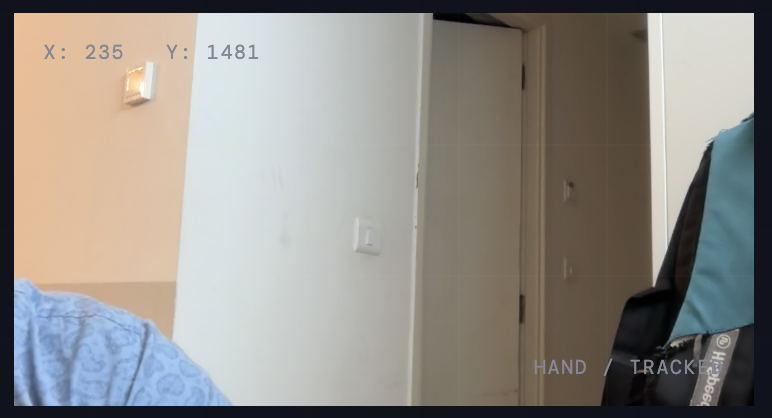

# AirBeat

## Play the air. Feel the beat.

AirBeat is a browser-based motion instrument that turns your webcam into a
virtual drum kit. Move your fingers through the on-screen instrument zones and
play synthesized drums in real time—no sticks, hardware, or installation
required.



> **Prototype status:** AirBeat is an interactive browser prototype. It uses
> TensorFlow.js HandPose for tracking and the Web Audio API for sound
> generation.

## Features

- Webcam-based hand and fingertip tracking.
- Two-hand and multi-finger performance support.
- Virtual kick, snare, hi-hat, tom, crash, and ride zones.
- Real-time hand skeleton overlay on the camera feed.
- Procedurally generated drum sounds using the Web Audio API.
- Master volume control and dynamics compression.
- Keyboard and pointer fallback controls when a camera is unavailable.
- Responsive dark interface designed for desktop and mobile browsers.
- No application backend or build step required.

## How it works

1. The browser requests camera access through `getUserMedia`.
2. TensorFlow.js HandPose detects up to two hands from the video stream.
3. AirBeat tracks the thumb and four fingertips independently.
4. A downward fingertip motion inside a drum zone triggers that instrument.
5. Web Audio API oscillators and filtered noise synthesize the sound locally.

All camera processing and sound generation happen in the browser. The camera
stream is not uploaded by this project.

## Tech stack

| Technology | Purpose |
| --- | --- |
| HTML5 | Application structure |
| CSS3 | Responsive visual design |
| JavaScript | Interaction, tracking, and audio orchestration |
| Web Audio API | Drum synthesis, gain, and compression |
| TensorFlow.js | In-browser ML runtime |
| HandPose | Hand landmark detection |

TensorFlow.js and HandPose are loaded from jsDelivr in
[`index.html`](./index.html).

## Run locally

### Requirements

- A modern browser such as Chrome, Edge, Firefox, or Safari.
- Python 3, Node.js, or another local static file server.
- A webcam and microphone permission is **not** required; AirBeat only asks
  for camera video.
- Internet access on first load, because the ML libraries are loaded from CDN.

### Start with Python

```bash
git clone https://github.com/Rasgulla812/AirBeat.git
cd AirBeat
python3 -m http.server 8000
```

Open [http://localhost:8000](http://localhost:8000).

### Start with Node.js

If you have the `serve` package available:

```bash
npx serve .
```

Open the URL printed in the terminal.

> Do not open `index.html` directly with `file://`. Camera permissions are
> generally blocked for local files; use `localhost` or HTTPS instead.

## Use AirBeat

1. Open the app from `localhost`.
2. Click **Enable sound** and confirm that the test hi-hat is audible.
3. Click **Start camera**.
4. Allow camera access when prompted.
5. Wait for **hands ready** and the hand model overlay.
6. Move one or both hands into the visible kit zones.
7. Make a quick downward finger motion to trigger a sound.

### Instrument layout

| Camera position | Instrument |
| --- | --- |
| Upper-left | Crash |
| Upper-center | Tom |
| Upper-right | Ride |
| Lower-left | Snare |
| Lower-center | Kick |
| Lower-right | Hi-hat |

### Keyboard and pointer controls

| Input | Sound |
| --- | --- |
| `Space` | Kick drum |
| `J` | Snare |
| `K` | Hi-hat |
| `L` | Tom drum |
| Click/tap a pad | Plays that pad |

The keyboard and pad controls are useful for testing audio before enabling the
camera.

## Troubleshooting

### The camera does not open

- Confirm the page is served from `http://localhost` or HTTPS.
- Allow camera access in the browser permission prompt.
- Check that another application is not using the camera.
- Reload after changing browser permissions.

### No sound plays

- Click **Enable sound** first; browsers block audio until a user gesture.
- Check the browser tab and system volume.
- Confirm the master volume slider is above zero.
- Test with the keyboard or a pad before testing hand motion.

### Hand tracking is slow or unavailable

- Wait for **Loading hand model** to complete.
- Use good lighting and keep your hands inside the camera frame.
- Move the camera farther away so the full hand is visible.
- Close other GPU-heavy browser tabs.
- Confirm the browser has internet access for the CDN model files.

### Fingers are detected but no drum triggers

- Move the fingertip into one of the labeled instrument zones.
- Make a distinct downward motion rather than holding the finger still.
- Keep the hand fully visible for more stable landmarks.
- Use the on-screen `HAND / ...` label to see the active zone.

## Project structure

```text
.
├── app.js              # Audio engine, camera flow, tracking, and gestures
├── index.html           # App markup and CDN dependencies
├── styles.css           # Responsive visual system and instrument overlay
├── docs/
│   └── prototype.png    # Prototype screenshot
└── README.md
```

## Development notes

This is a dependency-free static prototype. There is currently no package
manager configuration or compilation step. Edit the source files and refresh
the browser to see changes.

Before opening a pull request:

```bash
node --check app.js
```

Manual testing should cover:

- Audio unlock and every keyboard/pad control.
- Camera permission granted and denied.
- Hand model loading and tracking.
- One-hand and two-hand gestures.
- Multiple fingertips playing different zones.
- Mobile viewport layout.

## Roadmap

- Add selectable kits and user-customizable sounds.
- Add a visual hit history and rhythm recorder.
- Add latency calibration for different cameras.
- Add offline model assets and a production bundling setup.
- Add accessibility options for color, motion, and keyboard mapping.
- Add automated browser tests for audio and gesture state transitions.

## Privacy

AirBeat uses the webcam only after you click **Start camera**. Video frames are
processed locally by TensorFlow.js in the browser and are not sent to a server
by this project. Stop the camera from the same button or revoke permission in
your browser settings.

## License

No license has been selected yet. Add a license before distributing AirBeat
outside your own development or prototype use.

## Credits

Built with the Web Audio API, TensorFlow.js, and HandPose.
